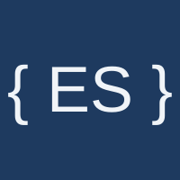

  
  &nbsp;&nbsp;<b>+</b>&nbsp;&nbsp;
  

  
  

# sdk-python

Python SDK for the [Everscribe](https://everscribe.io) API. It exposes **middleware** that records an audit event per request, a **recorder** for writing append-only audit events directly, and a **minter** for issuing short-lived browser tokens for [embeddable components](https://github.com/everscribe/components).

## Coding with Claude?

Install the [`es` CLI](https://github.com/everscribe/cli) to download the [Claude Code Setup Skill](https://everscribe.io/docs/quickstart/skill), which finds your handlers, proposes audit events, and wires up the SDK and [embeddable component](https://github.com/everscribe/components) for you.

## Python SDK reference

| Page | Covers |
|---|---|
| [Install](https://everscribe.io/docs/sdks/python-install) | `pip install` and the framework extras. |
| [Credential binding](https://everscribe.io/docs/sdks/python-credential-binding) | `everscribe.new`, `new_from_env`, and single-surface constructors. |
| [Event shape](https://everscribe.io/docs/sdks/python-event-shape) | The `Event` dataclass and its fields. |
| [BufferedRecorder](https://everscribe.io/docs/sdks/python-buffered-recorder) | Options, overflow policies, `close`, `flush` and delivery failures. |
| [Middleware and interceptors](https://everscribe.io/docs/sdks/python-asgi-middleware) | ASGI, Flask, Django and gRPC adapters, actor resolvers. |
| [Recorder](https://everscribe.io/docs/sdks/python-recorder) | Diffs, redaction, several events per request, direct recording. |
| [Minter](https://everscribe.io/docs/sdks/python-minter) | Embed tokens, tenant scoping, `TokenOptions`. |
| [Idempotency](https://everscribe.io/docs/sdks/python-idempotency) | `idempotency_key` and `auto_idempotency_key`. |
| [Errors](https://everscribe.io/docs/sdks/python-errors) | `HTTPError`, `NetworkError`, `EncodeError` and the other error types. |
| [Behaviors worth knowing](https://everscribe.io/docs/sdks/python-behaviors) | Empty `action`, non-blocking `record()`, caller-set fields. |

## Additional resources

- [Runnable examples](https://github.com/everscribe/examples): full-stack runnable
apps for every Everscribe SDK.

- [AI-assisted setup demo](https://github.com/everscribe/ai-assisted-setup-demo): Sample repo for trying AI setup against something disposable.

- [Everscribe CLI](https://github.com/everscribe/cli): CLI for downloading the Claude skill and managing projects, API keys, events and more.

- [Embeddable components](https://github.com/everscribe/components): drop-in audit
trail UI for single and multi-tenant apps.
